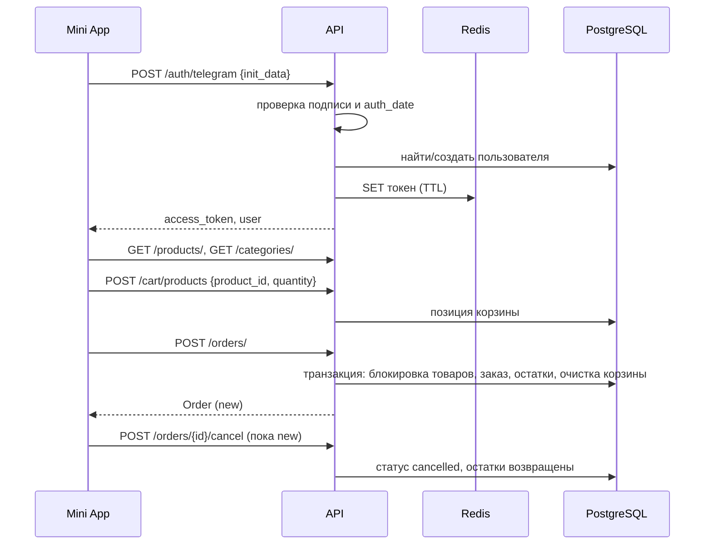

# Сценарии

Сквозные сценарии пользователя. Подробности каждого шага — в `DATA_FLOWS.md` и `INVARIANTS.md` доменов.

## Путь покупателя



## Сценарии по доменам

| Сценарий | Где описан |
|---|---|
| Вход, проверка токена, выход | [auth/DATA_FLOWS.md](auth/DATA_FLOWS.md) |
| Оформление заказа, отмена, смена статуса, жизненный цикл | [orders/DATA_FLOWS.md](orders/DATA_FLOWS.md) |

## Управление каталогом (админ)

```
1. POST /categories/                      (slug уникален)
2. POST /products/  {category_id, price, stock, is_active}
3. PATCH /products/{id} {stock | price | is_active}
4. DELETE /products/{id}    → 409, если товар уже в заказах (тогда is_active=false)
   DELETE /categories/{id}  → 409, если есть товары или подкатегории
```

## Выдача прав админа

```
1. Пользователь входит через Telegram → создаётся с ролью user
2. SQL: UPDATE users SET role='admin' WHERE telegram_id = <id>   (см. README)
3. Роль читается при каждом запросе — действует сразу, перевход не нужен
```
