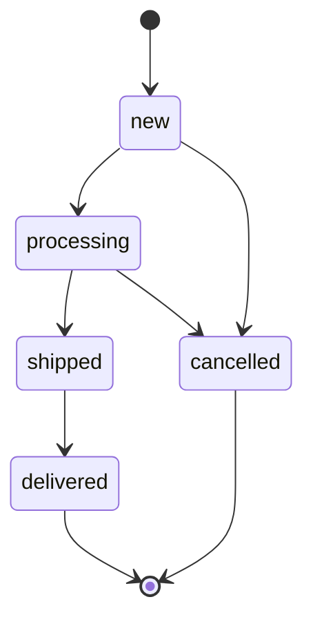

# orders — сценарии

## Оформление заказа

```
POST /orders/ → CreateOrderFromCart(user_id) → OrderService → PostgresOrderRepository.create_from_cart
  одна транзакция (`Database.transaction()`):
    корзина пуста                       → EmptyCart          (409)
    один SELECT ... ORDER BY id FOR UPDATE по всем товарам корзины
      (единый порядок блокировок: встречные заказы не дают deadlock)
    для каждой позиции:
      товар неактивен                   → ProductUnavailable (409)
      остаток < количества              → InsufficientStock  (409)
    total = Σ price × quantity
    создать Order(new) + OrderItem со снимком цены и названия
    stock -= quantity; удалить позицию корзины
  любое исключение → откат: заказ не создан, остатки и корзина не тронуты
```

## Отмена владельцем

```
POST /orders/{id}/cancel → CancelOrder → OrderService.cancel_by_owner
  get_visible (чужой → 404)
  repo.set_status(cancelled, allowed_from={new}, restore_stock=True)
```

## Смена статуса админом

```
PATCH /orders/{id}/status → UpdateOrderStatus → OrderService.change_status
  allowed_from = статусы, из которых по ALLOWED_TRANSITIONS можно перейти в status
  repo.set_status(status, allowed_from, restore_stock = (status == cancelled))
```

`set_status` в одной транзакции: `SELECT … FOR UPDATE` по заказу → текущий статус не в
`allowed_from` → 409 → смена статуса и (при отмене) возврат остатков. Проверка идёт под
блокировкой, поэтому параллельные отмены владельцем и админом не вернут остаток дважды:
вторая увидит `cancelled` и получит 409.

Жизненный цикл:



`new → cancelled` доступен и владельцу; остальные переходы — только админу.
