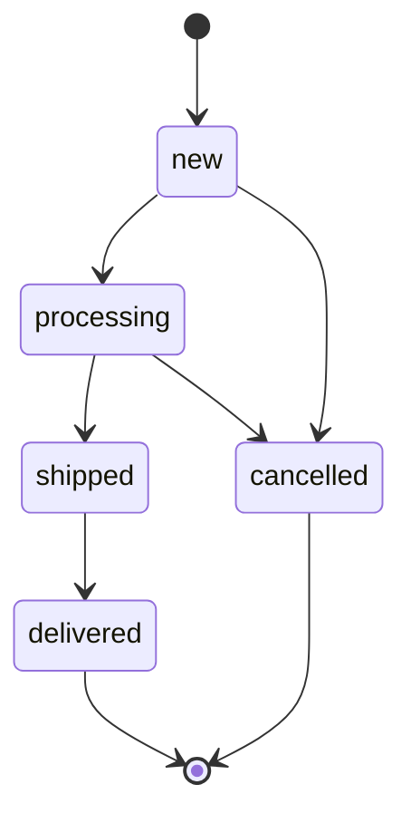

# orders — сценарии

## Оформление заказа

```
POST /orders/ → CreateOrderFromCart(user_id) → OrderService → PonyOrderRepository.create_from_cart
  один db_session (одна транзакция):
    корзина пуста                       → EmptyCart          (409)
    для каждой позиции: SELECT ... FOR UPDATE по товару
      товар неактивен                   → ProductUnavailable (409)
      остаток < количества              → InsufficientStock  (409)
    total = Σ price × quantity
    создать Order(new) + OrderItem со снимком цены и названия
    stock -= quantity; удалить позицию корзины
  любое исключение → откат: заказ не создан, остатки и корзина не тронуты
```

## Отмена владельцем

```
POST /orders/{id}/cancel → CancelOrder → OrderService.cancel_by_owner
  get_visible (чужой → 404) → статус ≠ new → 409
  repo.set_status(cancelled, restore_stock=True)   # статус и возврат остатков атомарно
```

## Смена статуса админом

```
PATCH /orders/{id}/status → UpdateOrderStatus → OrderService.change_status
  переход не в ALLOWED_TRANSITIONS → 409
  repo.set_status(status, restore_stock = (status == cancelled))
```

Жизненный цикл:



`new → cancelled` доступен и владельцу; остальные переходы — только админу.
