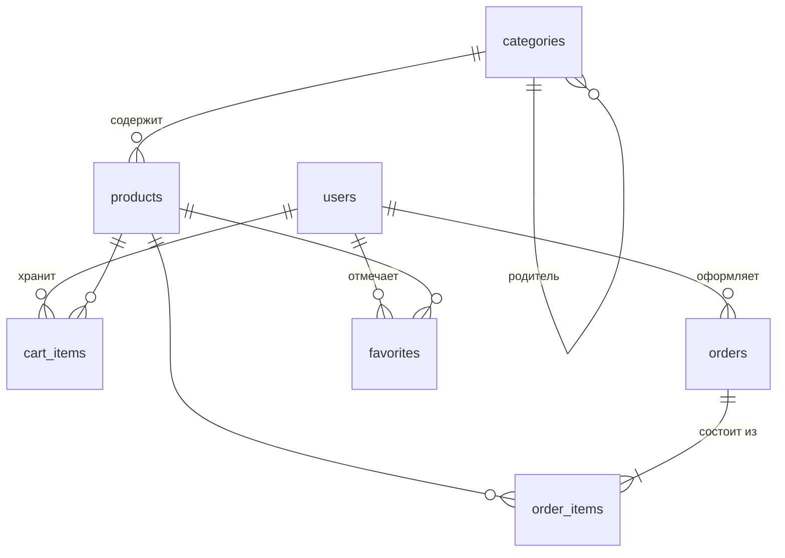

# shared — БД, ORM, миграции, исключения, настройки, логи

Код общий для всех доменов: [`src/shared`](../../../src/shared), [`settings.py`](../../../settings.py),
[`migrations/`](../../../migrations/sql/db.sql). Бизнес-логики здесь нет.

## Модель данных

| Таблица | Ключевые поля и ограничения БД |
|---|---|
| `users` | `telegram_id BIGINT UNIQUE`, `role` enum `user`/`admin` |
| `categories` | `slug UNIQUE`, `parent_id → categories` |
| `products` | `slug UNIQUE`, `sku UNIQUE` (может быть `NULL`), `price >= 0`, `stock >= 0`, `compare_at_price >= price`, `category_id → categories`, `fts` (tsvector, триггер) |
| `cart_items` | `UNIQUE(user_id, product_id)`, `quantity BETWEEN 1 AND 1000` |
| `orders` | `status`, `total_price >= 0`, `user_id → users` |
| `order_items` | `price >= 0`, `quantity > 0`, `order_id → orders`, `product_id → products` (RESTRICT) |
| `favorites` | `UNIQUE(user_id, product_id)` |

Схема — [`db.sql`](../../../migrations/sql/db.sql). ORM-сущности (`Pony*`) —
[`shared/orm/models.py`](../../../src/shared/orm/models.py); доменные pydantic-модели от них
независимы, адаптеры переводят одно в другое.

## Миграции

[`create_tables_from_migrations`](../../../src/shared/db.py) на старте применяет каждый `.sql`
из каталога миграций один раз; имена применённых лежат в `schema_migrations`. Если этой
таблицы нет, но есть `users`, БД считается уже мигрированной (совместимость со старыми
установками). Повторный запуск безопасен.

## Настройки

Один класс на подсистему, читаются только через [`settings.py`](../../../settings.py) и
регистрируются в [`di.py`](../../../di.py). Секреты — `SecretStr`. Обязательные переменные
проверяются при старте.

| Класс | Префикс | Переменные (по умолчанию) |
|---|---|---|
| `ServerSettings` | `SERVER_` | `HOST`, `PORT`, `ALLOWED_ORIGINS` (JSON-список, `*` запрещён), `FORWARDED_ALLOW_IPS` (`127.0.0.1`, `*` запрещён), `DOCS_ENABLED` (`true`; в compose по умолчанию `false`) |
| `DatabaseSettings` | `DB_` | `PROVIDER`, `HOST` (`localhost`), `PORT` (`5432`), `USER`, `PASSWORD`, `NAME`, `SCHEMA`, `MIGRATIONS_PATH` |
| `RedisSettings` | `REDIS_` | `HOST`, `PORT` (`6379`), `DB` (`0`), `PASSWORD`, `SSL`, `TIMEOUT`, `PREFIX` (`app:`) |
| `JWTSettings` | `JWT_` | `SECRET_KEY`, `ALGORITHM` (`HS256`), `ACCESS_TOKEN_EXPIRES_MINUTES` (720, допустимо 1…10080) |
| `TelegramSettings` | `TELEGRAM_` | `BOT_TOKEN`, `INIT_DATA_MAX_AGE_SECONDS` (86400) |

Обязательны без значения по умолчанию: `DB_PASSWORD`, `REDIS_PASSWORD` (compose), `JWT_SECRET_KEY`, `TELEGRAM_BOT_TOKEN`, `SERVER_ALLOWED_ORIGINS`
(плюс `DB_USER`, `DB_NAME`, `DB_SCHEMA`, `DB_PROVIDER`, `SERVER_*` в compose задаются сами). Образец — [`.env.example`](../../../.env.example).

## Исключения

[`shared/exceptions.py`](../../../src/shared/exceptions.py): все бизнес-ошибки — `DomainException`.
Домены их бросают, HTTP-статус назначает только [`server_factory`](../../../src/bootstrap/server_factory.py).

| Исключение | HTTP | Когда |
|---|---|---|
| `NotFoundException` | 404 | объект не найден; для чужого заказа тоже |
| `MappingException` | 400 | ошибка преобразования данных |
| `UniqueViolationException` | 409 | нарушена уникальность (slug, sku, telegram_id, позиция корзины/избранного) |
| `ProductInUseException` | 409 | удаление товара, попавшего в заказ |
| `CategoryNotEmptyException` | 409 | удаление категории с товарами/подкатегориями |
| `InvalidCategoryParentException` | 422 | родитель категории — она сама или её потомок |
| `InvalidProductPriceException` | 422 | `compare_at_price` меньше `price` (в том числе после PATCH одного из полей) |
| `InvalidCartQuantityException` | 422 | сумма количества позиции корзины больше 1000 |
| `EmptyCartException` | 409 | заказ при пустой корзине |
| `InsufficientStockException` | 409 | остаток меньше количества в корзине |
| `ProductUnavailableException` | 409 | товар в заказе неактивен |
| `InvalidOrderTransitionException` | 409 | переход статуса вне матрицы |
| `InvalidInitDataException` | 401 | подпись `initData` не сошлась / нет полей |
| `InitDataExpiredException` | 401 | `auth_date` слишком старый или «из будущего» |
| `NotAuthenticatedException` | 401 | нет заголовка `Authorization` или схема не `Bearer` |
| `TokenException` (`TokenExpired…`, `InvalidToken…`) | 401 | токен просрочен, не подписан, отозван; пользователь удалён |
| `PermissionDeniedException` | 403 | не админ на admin-endpoint |

Формат ответа об ошибке: `{"detail": "<сообщение>"}`; ошибки валидации запроса — 422
с подробным телом (см. [bootstrap](../bootstrap/ARCHITECTURE.md)).

## Логи

[`shared/logger.py`](../../../src/shared/logger.py): корневой логгер, вывод в консоль и в
`logs/bot.log` (JSON, ротация 1 МБ × 5). Успех сценария пишет use case (`INFO`, константное
сообщение, в `extra` только id/коды), бизнес-отказ — `WARNING` в одном месте
([`http_exception_wrapper`](../../../src/bootstrap/utils/http_exception_wrapper.py)).
Секреты и данные пользователя в логи не пишутся: `LoggingMiddleware` маскирует токены и `initData` ([`mask_headers`/`mask_body`](../../../src/bootstrap/utils/logging_middleware.py)).
